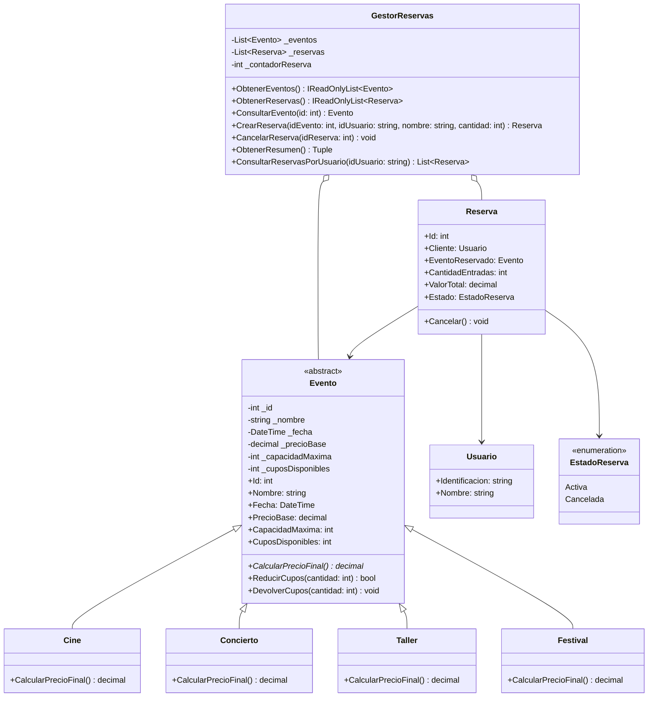
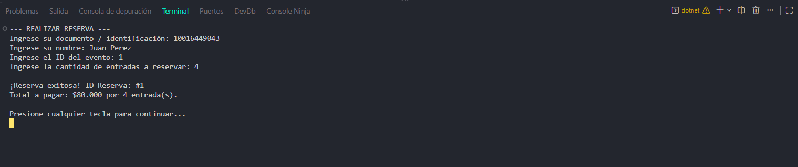
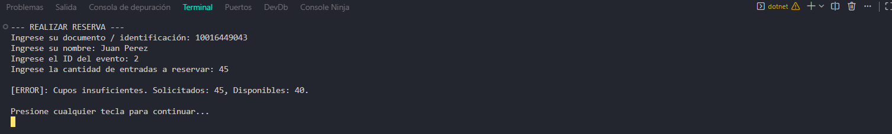
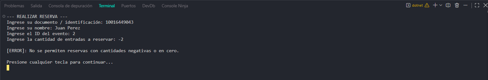
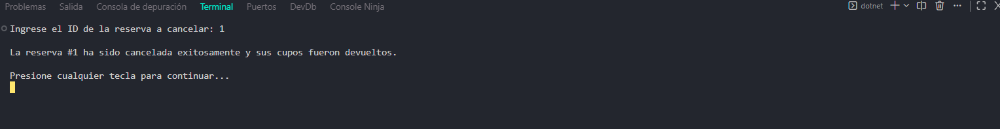
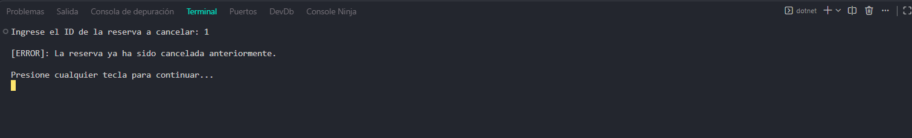
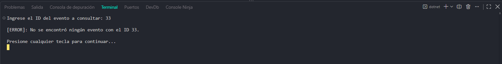
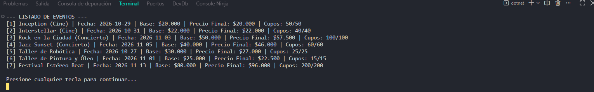

# PLANAZO - Sistema de Gestión de Eventos en C# y .NET

Aplicación de consola desarrollada en **C# y .NET** para la gestión integral de eventos, consulta de disponibilidad de cupos, reserva de entradas y cancelaciones, aplicando los principios fundamentales de la **Programación Orientada a Objetos (POO)**

---

## 1. Descripción de la Aplicación
PLANAZO es una plataforma de entretenimiento que administra diferentes tipos de actividades: funciones de cine, conciertos y talleres. El sistema permite a los usuarios:
* Visualizar eventos disponibles con cálculo dinámico de tarifas según la categoría.
* Consultar información detallada de cada evento mediante su identificador.
* Realizar reservas controlando la disponibilidad en tiempo real.
* Cancelar reservas registradas y restaurar automáticamente los cupos al inventario.
* Visualizar métricas consolidadas sobre recaudación y ocupación.
* Gestionar reservas por usuario mediante su documento de identidad (Reto Adicional 2).

## 2. Instrucciones de Ejecución

Para clonar y ejecutar este proyecto localmente o a través de **GitHub Codespaces**:
1. Abrir la terminal en la raíz del proyecto donde se encuentra el archivo de solución o proyecto `.csproj`.
2. Restaurar y compilar la solución:
   ```bash
   dotnet build
   ```
3. Ejecutar la aplicación:
   ```bash
   dotnet run
   ```
## 3. Estructura del Proyecto y Relación de Clases

El proyecto está organizado siguiendo el principio de separación de responsabilidades:

```text
PLANAZO-POO-CSharp/
│
├── Program.cs                  # Interfaz de consola, menús y captura de datos
│
├── Modelos/                    # Entidades del dominio del negocio
│   ├── Evento.cs               # Clase abstracta base
│   ├── Cine.cs                 # Derivada: mantiene precio base
│   ├── Concierto.cs            # Derivada: recargo del 15%
│   ├── Taller.cs               # Derivada: descuento del 10%
│   ├── Festival.cs             # Derivada (Reto 1): recargo del 20%
│   ├── Usuario.cs              # Entidad para gestión de clientes 
│   └── Reserva.cs              # Asociación entre Usuario y Evento
│
├── Servicios/
│   └── GestorReservas.cs       # Lógica de negocio, colecciones y validaciones
│
├── Capturas/                   # Evidencias de pruebas de ejecución
└── README.md                   # Documentación técnica del repositorio
```

### Relaciones entre clases:
* **Herencia (`is-a`):** `Cine`, `Concierto`, `Taller` y `Festival` heredan de la clase base abstracta `Evento`
* **Asociación / Composición (`has-a`):** Cada `Reserva` contiene una referencia a un objeto `Usuario` (el comprador) y a un objeto `Evento` (el evento reservado).
* **Agregación:** La clase de servicio `GestorReservas` administra colecciones (`List<Evento>` y `List<Reserva>`) para coordinar las operaciones del sistema.

## 4. Conceptos de POO Implementados

| Concepto POO | Implementación en el Código |
| :--- | :--- |
| **Abstracción** | Se implementó la clase abstracta `Evento`. Modela los atributos esenciales (`Id`, `Nombre`, `Fecha`, `PrecioBase`, `CapacidadMaxima`, `CuposDisponibles`) y define el contrato obligatorio del método `CalcularPrecioFinal()` sin imponer una implementación rígida. |
| **Encapsulamiento** | Las propiedades de los modelos cuentan con accesores controlados (`get; private set;`). Los estados internos como `CuposDisponibles` solo se modifican a través de métodos seguros como `ReducirCupos(int)` y `DevolverCupos(int)`, previniendo inconsistencias. |
| **Herencia** | Se extienden las características de `Evento` hacia clases especializadas (`Cine`, `Concierto`, `Taller`, `Festival`) mediante la reutilización de constructores base (`base(...)`) y código común. |
| **Polimorfismo** | Cada subclase sobrescribe el método abstracto `CalcularPrecioFinal()` (`override`) aplicando su propia regla financiera:<br>• `Cine`: Precio base.<br>• `Concierto`: Precio base * 1.15.<br>• `Taller`: Precio base * 0.90.<br>• `Festival`: Precio base * 1.20. |
| **Colecciones** | Se utilizó `List<T>` dentro de `GestorReservas` para almacenar y consultar dinámicamente eventos y reservas en memoria. |
| **Manejo de Excepciones** | Implementación de bloques `try-catch` y lanzamiento de excepciones (`ArgumentException`, `InvalidOperationException`, `KeyNotFoundException`) para garantizar que datos inválidos o desbordes no cierren inesperadamente el programa. |

## 5. Retos Adicionales Implementados (Calificación 5,0)

1. **Reto 1 (+0,2) — Nuevo Tipo de Evento:** Se creó la clase `Festival.cs` que hereda de `Evento`, implementando un recargo del 20% sobre el precio base sin alterar ninguna clase preexistente.
2. **Reto 2 (+0,2) — Gestión de Usuarios:** Se integró la entidad `Usuario.cs` para vincular cada reserva a una persona por documento, habilitando la opción en el menú para consultar todas las reservas de un usuario específico.
3. **Reto 3 (+0,1) — Diagrama de Clases UML:** Se diseñó la estructura completa del sistema en notación UML.

## 6. Diagrama de Clases UML (Reto 3)



---

## 7. Pregunta de Sustentación

**Pregunta:**  
*¿Por qué utilizaste una clase abstracta `Evento` en lugar de crear clases completamente independientes para Cine, Concierto y Taller? ¿Qué ventajas tiene esta decisión cuando necesitamos agregar un nuevo tipo de evento?*
**Respuesta Técnica:**  
El uso de la clase abstracta `Evento` responde a dos pilares esenciales de la POO: **reutilización de código** y **diseño desacoplado**

1. **Evita la redundancia:** Si `Cine`, `Concierto` y `Taller` fueran independientes, tendríamos que duplicar en cada una de ellas los mismos campos (`Id`, `Nombre`, `Fecha`, `PrecioBase`, `CuposDisponibles`), así como los métodos de control de aforo (`ReducirCupos` y `DevolverCupos`). Centralizar esto en `Evento` permite mantener el código ordenado y en un único punto de verdad.
2. **Habilita el Polimorfismo:** Al tener un tipo base común, el sistema de almacenamiento en `GestorReservas` puede manejar una única lista genérica `List<Evento>`. Cuando se procesa una reserva o se calcula el total, el gestor solo llama a `evento.CalcularPrecioFinal()` sin importar el tipo específico del objeto en tiempo de compilación; en tiempo de ejecución, el entorno invoca la implementación correcta.
3. **Facilidad de Extensión (Principio Open/Closed):** Cuando se solicitó el nuevo tipo de evento (`Festival`), **no fue necesario modificar ninguna clase existente ni alterar la lógica del gestor ni del menú**. Simplemente se creó la nueva clase derivada `Festival : Evento` y se añadió a la lista, garantizando escalabilidad y mantenimiento sin efectos colaterales.


## 8. Evidencias de Casos de Prueba

Las capturas de pantalla ubicadas en la carpeta `Capturas/` evidencian el funcionamiento y validación de los escenarios requeridos

### Caso 1: Registrar una reserva válida
*Se reserva una cantidad permitida dentro de los cupos disponibles, calculando el valor total correctamente.*


### Caso 2: Intentar reservar más entradas que los cupos disponibles
*El sistema intercepta la petición, muestra el mensaje de error controlado y no altera los cupos existentes.*


### Caso 3: Intentar realizar una reserva con cantidad negativa o cero
*Validación de entrada que impide cantidades menores o iguales a cero.*


### Caso 4: Cancelar una reserva y comprobar devolución de cupos
*Se cancela una reserva activa y se evidencia en la consulta del evento que los cupos fueron restituidos.*


### Caso 5: Intentar cancelar dos veces la misma reserva
*El sistema valida el estado de la reserva e impide que una reserva ya cancelada vuelva a procesarse.*


### Caso 6: Consultar un evento inexistente
*Control de excepción por ID no encontrado sin interrumpir la ejecución de la consola.*


### Caso 7: Comprobación de precios finales por tipo de evento
*Demostración del polimorfismo en el cálculo: Cine (base), Concierto (+15%), Taller (-10%) y Festival (+20%).*

